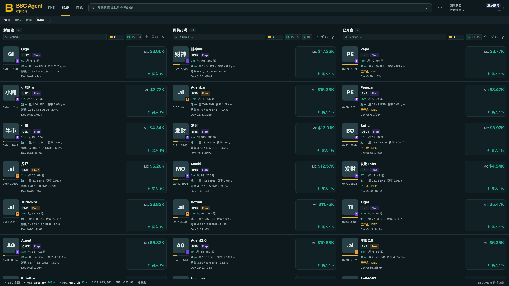

<p align="center">
  
</p>

<h1 align="center">BSC Agent</h1>

<p align="center">A BSC market and trading terminal that runs on your own computer: trenches, charts, quick trade, wallet tracking and gang.fun sniping.</p>

<p align="center"><a href="README.md">简体中文</a> · <b>English</b></p>

<p align="center">
  
</p>

> **In one line:** download → `./install.sh` → `./start.sh` → sign in to your Binance wallet in the browser and you're ready. Private keys never live on this machine, and the service listens on `127.0.0.1` only.

---

## Contents
1. [What it does](#what-it-does)
2. [Quick start (3 minutes)](#quick-start-3-minutes)
3. [Using the interface](#using-the-interface)
4. [Safety notes (read first)](#safety-notes-read-first)
5. [Updates: GitHub new-version reminder](#updates-github-new-version-reminder)
6. [Configuration](#configuration)
7. [FAQ](#faq)
8. [Development and testing](#development-and-testing)
9. [License and disclaimer](#license-and-disclaimer)

## What it does
- **Trenches:** New / Near Graduation / Launched columns covering Flap, Four and gang.fun (Gang V1 / V2 / V3 and fair launch). Every token card uses the same fixed layout: name → pool quote asset · tax · launch mode → pool size / tags → age · holders · trades → Dev / first buyer.
- **Filters:** three presets (P1 / P2 / P3) per column; filter by platform, quote asset, age, market cap, holders, progress, tax and social links. Saved automatically.
- **Charts and trades:** launched tokens merge on-chain trades with external-pool history; market cap / price toggle; 1s to 1h intervals; buy and sell markers.
- **Market page:** the left tabs (In curve / Soon / Migrated / Mine) use the same filters as the matching trench columns; the token header shows price, change, market cap, liquidity, volume, holders, fees and platform links in a single row.
- **Quick trade:** quick buy, sell-all, slippage, and allowance review / revoke. Trades go through Binance's aggregator and fall back to PancakeSwap V2 directly for brand-new pools the aggregator doesn't know.
- **Tracking / copy trading:** follow smart-money addresses and copy their buys with your own amount, take-profit and stop-loss.
- **gang.fun sniping:** buy new launches right away. You decide how much per buy, how many tokens per day (unlimited by default) and the auto-sell rules.
- **Free-mint script:** `node scripts/free-mint.mjs 0xContract…` probes the free quantity, runs a `baw` preview safety check and only then mints; paid mints are only quoted, never executed; `--dry` checks without sending.
- **Pause everything:** one button in the top-right stops tracking and sniping together.
- **Self-check page:** wallet, live-trading switch and every module at a glance, with plain-language hints when something is wrong.
- **Single wallet:** only the one Binance Agentic Wallet you sign in with. There are no multi-wallet options in the interface.

## Quick start (3 minutes)
**Requirements:** macOS or Linux, Node.js 22 or newer.

```bash
git clone https://github.com/H-eartbreaker/bsc-agent.git
cd bsc-agent
./install.sh      # checks Node, installs dependencies, creates .env, installs the Binance wallet CLI (baw)
./start.sh        # starts the service and opens http://localhost:8787
```

The first launch shows a **guide plus a self-check**. Follow it in order:
1. **Sign in to the Binance wallet:** a sign-in window pops up in the middle of the page. Click **Sign in to Binance wallet** → open the link it gives you → check the pairing code → confirm in the **Binance App**. The page detects it automatically; no commands needed. (If the wallet tool isn't installed, the window shows the install command with a Copy button.)
2. Open **🩺 Self-check** at the bottom-left of the footer. The first four items must show ✓.
3. In **Tracking / gang.fun sniping**, set **how much to buy each time**, and test with a very small amount first.
4. To stop everything: **Pause all** at the top-right.

> If market sites are unreliable on your network, just turn on your proxy app — the app finds the proxy automatically. If it can't, enter the proxy address on the self-check page (see FAQ).

## Using the interface
| Where | What it does |
|---|---|
| Top navigation: Market / Trenches / Tracking·Sniping | The three main pages, text navigation with the current page highlighted |
| GitHub icon (top-right) | Opens the project repository; shows a red dot and a pop-up when a new version is on GitHub |
| Wallet name + balance (top-right) | Click to copy the wallet address and see the sign-in status |
| Trench column header | Keyword search, per-column ⚡ buy amount, P1–P3 presets, sound, hidden-token count, filter funnel |
| Trench card | Click the MC / buy area on the right to ⚡ buy; ⊘ to hide a token; click the card for details |
| Tracking / gang.fun sniping | Fixed switcher at the top; set the amount, save, then turn on (real buying) |
| Left token list | Drag the divider to resize; double-click it to reset |
| Footer: self-check / version | Self-check page, version number and update notice |

## Safety notes (read first)
This is third-party software that moves real funds and **has not had a formal security audit**. Test with small amounts first.
- Real orders require `MODE=live`, `LIVE_TRADE=1`, a signed-in wallet and your confirmation in the interface.
- Tracking and sniping are **off by default** and are **never turned on automatically** after a restart.
- The server listens on `127.0.0.1` only. Never forward the port to the internet.
- Keep RPC keys, transfer addresses and other private settings in the local `.env` and never commit them. The `data/` folder (positions, history, tokens) is ignored by Git.
- Auto-transfer, auto-claim and large allowance pre-approval are off by default.

## Updates: GitHub new-version reminder
- The app periodically checks this repository's version number. When a higher version exists, the **GitHub icon in the top-right shows a red dot and a pop-up** with the release notes.
- In the pop-up choose **Remind me later**, **Don't remind for this version**, or **Open GitHub**.
- **It only reminds — it never updates by itself.** To update:
  ```bash
  git pull
  npm install
  # then restart the service (stop it and run ./start.sh again)
  ```
  Your wallet, settings and records (`data/`, `.env`) are not touched.
- To check a different repository set `BSC_AGENT_UPDATE_REPO=user/repo` in `.env`; to turn the reminder off set `BSC_AGENT_UPDATE=0`.
- Release notes for every version are in [CHANGELOG.en.md](CHANGELOG.en.md).

## Configuration
Copy `.env.example` to `.env` and adjust as needed (`install.sh` already does this for you):

| Variable | Default | Purpose |
|---|---:|---|
| `MODE` | `live` | Live mode (default) |
| `PORT` | `8787` | Local port |
| `LIVE_TRADE` | `1` | `1` allows real orders once signed in; `0` is read-only / quote-only |
| `MAX_TRADE_BNB` | `0.5` | Maximum BNB per buy, a safety valve |
| `NODEREAL_RPC` / `NODEREAL_KEYS` | empty | Private BSC RPC; keep in `.env` only |
| `BSC_AGENT_PROXY` | empty | Proxy for market data sites, e.g. `http://127.0.0.1:7897` |
| `BAW_BIN` | `baw` | Path of the Binance wallet CLI |
| `AUTO_TRANSFER_TO` | empty | Auto-transfer destination (can also be set in the app; changing it needs a second confirmation) |
| `BSC_AGENT_PROXY` | auto | Force a proxy (usually not needed; `none` disables the proxy) |
| `BSC_AGENT_UPDATE_REPO` | official repo | Repository the new-version reminder checks |
| `BSC_AGENT_UPDATE` | on | Set `0` to turn the reminder off |
| `MYSQL_URL` / `REDIS_URL` | empty | Optional history cache; `scripts/enable-cache.sh` starts both with Docker |

## FAQ
- **Tokens have no avatars and the pool shows "—"?** Avatars, pool size and charts come from overseas data sites. The app finds a proxy automatically (direct first, then the system proxy, then common ports). If there are still no avatars, open your proxy app, then open **🩺 Self-check** in the footer: under "can reach the market data sites" there is an input box. Paste the HTTP proxy address from your proxy app (like `http://127.0.0.1:port`; look for "HTTP proxy port" or "mixed port" in Clash / V2Ray settings) and click **Save & test**. It takes effect immediately, no restart.
- **The top-right says "demo account" and the page looks like a demo?** You are using an old `.env`. Update to the latest version (`git pull`) and restart, or delete the `MODE=sim` line from `.env`, or run `cp .env.example .env` again.
- **The top-right says the wallet isn't signed in?** Click it, press **Sign in to Binance wallet** in the window that appears and confirm in the Binance App. You can also run `baw auth signin` in a terminal.
- **A chart has a gap or differs from another site?** History comes from GeckoTerminal and DexScreener, whose free APIs are rate-limited. A yellow note above the chart explains why. For newly opened tokens the history is back-filled in the background, so wait a few minutes. If the network is blocked, set `BSC_AGENT_PROXY`.
- **A buy fails?** The page explains the reason in plain language (insufficient balance, slippage too low, wallet not signed in…). You can also open the self-check.
- **Nothing changed after updating the code?** Restart the service and hard-refresh the browser (Cmd/Ctrl+Shift+R).
- **How do I stop all automation?** Use **Pause all** at the top-right, or just stop the service.

## Development and testing
```bash
npm test                    # all unit tests
node --check public/app.js  # front-end syntax check
```
`engine/` is the backend (market data, trading, tracking, sniping), `public/` is the static front end, and `server.js` is the entry point. Before opening a PR make sure tests pass and that no `.env`, `data/` or personal information is included.

## License and disclaimer
Released under the MIT License, see [LICENSE](LICENSE). `public/vendor/` keeps the license files of its third-party libraries.

Token prices, liquidity, taxes and platform APIs change quickly, and every trade can lose money or become impossible to sell. The authors do not give investment advice and are not responsible for any financial loss.
